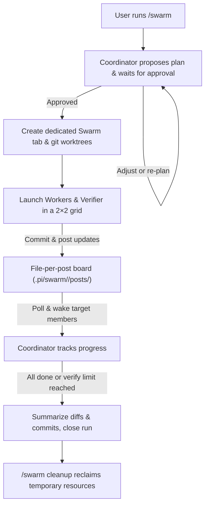

English | [简体中文](./README_zh.md)

# Swarm — Multi-Agent Team Extension for `pi`

[](#license)
[](https://nodejs.org/)
[](#prerequisites)
[](#testing--development)

**Split complex coding tasks across a team of parallel `pi` agents—each working in its own isolated git worktree—and review everything from one clean window.**

> [!NOTE]
> Add a screenshot or terminal recording below to showcase Swarm in action:
>
> `<!-- TODO: Add screenshot or terminal recording here:  -->`

---

## Table of Contents

- [Why Swarm](#why-swarm)
- [Quick Start](#quick-start)
- [Daily Usage Guide](#daily-usage-guide)
  - [Commands & Shortcuts](#commands--shortcuts)
  - [Model Configuration](#model-configuration)
  - [Live Monitoring & Dedicated Tab](#live-monitoring--dedicated-tab)
- [Architecture & Developer Reference](#architecture--developer-reference)
- [Roadmap & License](#roadmap--license)

---

## Why Swarm

When a task spans several modules, a single coding agent hits two limits quickly: **the context window fills up**, and **independent pieces of work have to wait in line**.

Swarm turns your current `pi` session into a **Coordinator**. It breaks the task into a clear plan for your approval, launches a team of **Workers** in isolated git worktrees to code in parallel, and optionally pairs them with a **Verifier** to run tests and review changes.

### Great Use Cases

- **Parallel multi-module changes**: Add unit tests, refactor APIs, or update docs across independent files at the same time.
- **Separation of coding and review**: Route fast models to Workers for implementation and a stronger model to the Verifier for testing and code review.
- **Guarded execution**: Each Worker stays within its assigned scope and must commit clean changes on its own branch before reporting completion.

### Highlights

- **Approve before anything runs**: Review the proposed roster, scope boundaries, precheck warnings, and session quota notice first. You can approve, tweak individual member models on the spot, or reject and re-plan.
- **Isolated worktrees with automatic rollback**: Every Worker gets its own git worktree and branch so edits never collide with your main workspace. If any member fails to launch, created panes, tabs, and worktrees are cleaned up automatically.
- **Uncluttered main window**: Team panes launch in a dedicated Herdr tab arranged as a 2×2 grid, keeping your coordinator pane full-width and readable.
- **Flexible per-role model routing**: Configure defaults globally or per project, override them on the command line, or adjust them right before launch. Anything left unset inherits the coordinator's current model.
- **Verification circuit breaker**: If the Verifier sends work back more times than allowed, Swarm pauses the loop and hands control back to you and the coordinator.

---

## Quick Start

### Prerequisites

- **`pi`**: `@earendil-works/pi-coding-agent` and `@earendil-works/pi-tui`
- **`herdr`**: Version `0.9.5+`, with your `pi` session running inside Herdr
- **Node.js `>= 24`**: Used to run the built-in test suite
- **`git`**: Recommended for worktree isolation; non-git directories run directly in the working directory

### Installation

Clone the repository into `pi`'s extensions directory:

```bash
git clone https://github.com/zerain050424/Pi-Swarm.git ~/.pi/agent/extensions/swarm
```

`pi` discovers and loads the extension automatically on startup.

### Run Your First Swarm in 3 Steps

1. Open a clean git repository inside a `herdr` terminal and start `pi`.
2. Run `/swarm` with your task:

```text
/swarm Add concise JSDoc comments to exported helpers in src/utils.ts and verify with tests
```

3. Review the proposed roster, scope boundaries, and assigned models in the confirmation prompt, then choose **Confirm Launch**.

You can keep talking to the coordinator in your main window while tracking progress via the compact status bar or the `Alt+S` monitor. Once the coordinator summarizes the commits, run `/swarm cleanup` to remove temporary branches and worktrees while keeping the message board logs in `.pi/swarm/`.

---

## Daily Usage Guide

### Commands & Shortcuts

| Command / Shortcut | Purpose |
|---|---|
| `/swarm <task>` | Ask the coordinator to plan the task and launch the team after confirmation. |
| `/swarm models` | Open an interactive menu to view or configure default role and member models. |
| `/swarm status` | Show the active run ID and each member's current status. |
| `/swarm abort` | Immediately stop an active run, close its panes/tab, and remove temporary worktrees. |
| `/swarm cleanup [run-id]` | Clean up panes, tabs, worktrees, and branches for finished runs while keeping archives. |
| `Alt+S` | Open the live-refreshing monitor overlay in the main window (TUI only). |

You can also override models for a single run directly from the command line without changing saved configs:

```text
/swarm --worker-model=provider/fast --verifier-model=provider/strong Fix the auth unit tests and verify
```

---

### Model Configuration

Swarm supports mapping models by **member name**, **role**, or **default fallback**. Configs live at two levels, with project settings overriding global settings per field:

- **Global config**: `~/.pi/agent/swarm-models.json`
- **Project config**: `<project-root>/.pi/swarm/models.json`

Example configuration:

```json
{
  "default": "provider/balanced-model",
  "roles": {
    "worker": "provider/fast-model",
    "verifier": "provider/strong-model"
  },
  "members": {
    "fix-1": "provider/special-model"
  }
}
```

> [!IMPORTANT]
> Always use a **fully-qualified `provider/model` name** such as `opencode-go/glm-5.3-flash`. Bare model names are rejected so child `pi` processes do not exit due to provider ambiguity.

#### Quick Subcommands

In addition to the interactive `/swarm models` menu, you can manage configs directly:

| Command | Description |
|---|---|
| `/swarm models show` | Display global, project, and effective merged settings. |
| `/swarm models set <target> <provider/model>` | Save a project-level override; append `--global` to save globally. |
| `/swarm models reset <target>` | Remove a project-level entry; append `--global` to remove a global entry. |

`<target>` accepts `worker`, `verifier`, `default`, or a member name such as `fix-1`.

#### Resolution Priority

When multiple settings exist, Swarm resolves each member's model from highest to lowest priority:

1. **Interactive launch adjustment**: Changes made via "Edit member model" in the confirmation menu.
2. **CLI flags**: `--worker-model` or `--verifier-model` passed to `/swarm`.
3. **Saved config files**: Project config overrides global config; within each layer, `members[name]` > `roles[role]` > `default`.
4. **Coordinator plan suggestion**: The optional `model` field proposed by the coordinator.
5. **Inherit coordinator**: If none of the above are set, the member uses the coordinator's current model.

---

### Live Monitoring & Dedicated Tab

Once launched, all Workers and the Verifier run in a dedicated Herdr tab laid out as a 2×2 grid. You can monitor them in two ways:

- **Live Monitor Overlay (`Alt+S`)**: Refreshes member statuses and terminal output every 2 seconds right inside your main window.
  - `↑` / `↓` or `1`–`5`: Switch the active member
  - `Tab`: Toggle between member output preview and the full message board
  - `r`: Refresh immediately
  - `f`: Jump to the dedicated Swarm tab to inspect the full 2×2 terminal grid
  - `q` or `Esc`: Close the overlay
- **Compact Status Widget**: Displays a single-line summary above the editor in TUI mode and clears automatically when the run finishes or aborts.

---

## Architecture & Developer Reference

> [!NOTE]
> This section is intended for contributors and maintainers. Everyday users only need the sections above.

### Workflow Overview



### Module Layout

| File | Side | Responsibility |
|---|---|---|
| [`index.ts`](./index.ts) | Coordinator | Registers `/swarm` commands and tools, manages the dedicated tab and 2×2 grid, wake routing, and `Alt+S` monitor. |
| [`models.ts`](./models.ts) | Coordinator | Dual-layer config I/O and merging, `provider/model` validation, 5-level priority resolution, and CLI flag parsing. |
| [`worker.ts`](./worker.ts) | Member | Loaded inside child `pi` instances; reads briefings on startup and exposes board posting and commit-checked completion tools. |
| [`board.ts`](./board.ts) | Shared | File-per-post frontmatter parsing/serialization, sequence allocation, filtering, and atomic post writes. |
| [`herdr.ts`](./herdr.ts) | Coordinator | CLI wrapper for `herdr` tabs, panes, agent control, and worktree helpers. |
| [`shared.ts`](./shared.ts) | Shared | Environment variable constants, run/member types, roster persistence, and briefing templates. |
| [`swarm.test.ts`](./swarm.test.ts) | Tests | Unit test suite powered by Node.js 24's built-in test runner. |

### Runtime Directory Layout

Each run stores its state and message history under `.pi/swarm/` so logs remain available even after worktrees and branches are cleaned up:

```text
.pi/swarm/
├── models.json                   # Optional project-level model config
└── <run-id>/
    ├── roster.json               # Run status, tab ID, and member roster
    ├── posts/
    │   └── NNNN-<from>-<type>.md # Message board posts
    └── wt-<agentName>/           # Isolated git worktree for each Worker
```

### Testing & Development

Run the full unit test suite using Node.js 24's native TypeScript support:

```bash
node --test swarm.test.ts
```

For manual end-to-end verification in a live `herdr` session, see [`e2e-phase1-2.md`](./e2e-phase1-2.md) and [`e2e-phase4.md`](./e2e-phase4.md).

**Contributing Guidelines:**

1. Keep `shared.ts`, `board.ts`, and `models.ts` free of `herdr` process calls so they stay safely importable and easy to test.
2. Follow the lifecycle boundaries in [`Design.md`](./Design.md): never spawn child processes, watchers, or timers inside the extension factory.
3. Add or update unit tests in [`swarm.test.ts`](./swarm.test.ts) using dependency injection for `HerdrExec` and `GitRunner` before opening a PR.

---

## Roadmap & License

### Roadmap

- Explicit `/swarm resume` command for manual cross-session handoff
- Concurrent multi-run support within a single coordinator session
- Unmerged-branch warning or merge helper prior to `/swarm cleanup`

### License

This project is licensed under the **MIT License** (placeholder — add a `LICENSE` file to confirm).
