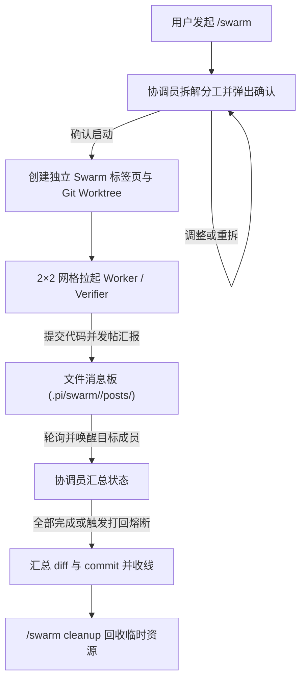

[English](./README.md) | 简体中文

# Swarm — `pi` 多智能体团队协作扩展

[](#许可证)
[](https://nodejs.org/)
[](#前置要求)
[](#测试与开发)

**把一个复杂的开发任务拆给多个并行工作的 `pi` 助手，各自独立改代码、互不干扰，再统一验收汇总。**
---

## 目录

- [为什么用 Swarm](#为什么用-swarm)
- [快速开始](#快速开始)
- [日常使用指南](#日常使用指南)
  - [常用命令与快捷键](#常用命令与快捷键)
  - [为不同角色配置模型](#为不同角色配置模型)
  - [实时监控与独立工作区](#实时监控与独立工作区)
- [架构与开发参考](#架构与开发参考)
- [路线图与许可证](#路线图与许可证)

---

## 为什么用 Swarm

当需求跨越多个模块时，单个 AI 助手往往会遇到两个瓶颈：**上下文很快塞满**，以及**所有步骤只能排队串行**。

Swarm 会把你当前的 `pi` 会话变成**协调员**。它会先帮你拆解任务、列出分工并请你确认，随后在独立的终端标签页和隔离的 Git 工作区里拉起一支 **Worker** 小队并行编码，必要时再配一名 **Verifier** 负责跑测试和审查改动。

### 什么场景适合试一试

- **跨模块并行改造**：例如同时给 3 个独立模块补单元测试、重构接口或补充文档注释。
- **编码与验收分离**：让速度更快的模型担任 Worker 写代码，让推理更强的模型担任 Verifier 审查差异并运行测试。
- **需要严格把关的改动**：每个 Worker 都只能在授权的目录范围内修改，必须先在自己的分支提交代码，才能向协调员汇报完成。

### 核心亮点

- **先确认、再动工**：正式启动前会弹出分工清单、预检提醒与会话配额提示。你可以直接确认、临时调整某个成员的模型，或者退回让协调员重新拆解。
- **工作区物理隔离**：每位 Worker 都在独立的 Git worktree 与分支中编码，彼此不抢文件，也不污染你当前的主工作区。若启动过程中任一成员出错，已创建的资源会自动回滚清理。
- **不挤占主窗口**：团队成员统一运行在单独的 Herdr 标签页中，按 2×2 网格自动排布。你面前的协调员窗口始终保持全宽整洁。
- **按角色灵活配模型**：支持全局配置、项目配置、启动参数覆盖和确认阶段微调。未单独指定时，自动沿用协调员当前模型。
- **自动验收与熔断**：Worker 提交后，Verifier 会跟进测试并提出修改意见；若来回打回超过上限，系统会自动暂停交由你和协调员拍板，避免无限循环。

---

## 快速开始

### 前置要求

- **`pi`**：已安装 `@earendil-works/pi-coding-agent` 与 `@earendil-works/pi-tui`
- **`herdr`**：版本 `0.9.5+`，且当前 `pi` 会话运行在 Herdr 终端内
- **Node.js `>= 24`**：用于运行本地单元测试
- **`git`**：推荐在 Git 仓库中使用；非 Git 目录下会直接在当前目录工作，不做分支隔离

### 安装

将本仓库克隆到 `pi` 的扩展目录即可生效：

```bash
git clone https://github.com/zerain050424/Pi-Swarm.git ~/.pi/agent/extensions/swarm
```

`pi` 会在启动时自动发现并加载该目录下的扩展。

### 3 步跑通第一个任务

1. 在 `herdr` 终端中进入一个干净的 Git 仓库，启动 `pi`。
2. 输入 `/swarm` 加上你的任务描述：

```text
/swarm 为 src/utils.ts 中的导出函数补充简洁的 JSDoc 注释并运行测试验证
```

3. 在确认界面核对成员分工、负责范围和各自使用的模型，选择**确认启动**。

接下来你就可以在主窗口继续和协调员对话，同时通过编辑器上方的状态栏或 `Alt+S` 随时查看团队进度。任务汇总完成后，运行 `/swarm cleanup` 即可清理临时分支和工作区，消息记录会自动保留在 `.pi/swarm/` 中。

---

## 日常使用指南

### 常用命令与快捷键

| 命令 / 快捷键 | 用途说明 |
|---|---|
| `/swarm <任务描述>` | 提交任务给协调员拆解分工，确认后拉起团队。 |
| `/swarm models` | 打开交互式菜单，管理默认模型和各角色的模型配置。 |
| `/swarm status` | 查看当前任务的运行 ID 及各成员的实时状态。 |
| `/swarm abort` | 紧急中止当前任务，关闭成员窗口并移除临时工作区。 |
| `/swarm cleanup [run-id]` | 清理已结束任务的窗口、临时工作区和分支，保留历史记录。 |
| `Alt+S` | 在主窗口打开实时监控面板，仅 TUI 模式有效。 |

在启动任务时，也可以直接通过参数临时覆盖本次使用的模型，不会改写持久化配置：

```text
/swarm --worker-model=provider/fast --verifier-model=provider/strong 修复认证模块的单测并验证
```

---

### 为不同角色配置模型

Swarm 支持按**成员名**、**角色**或**默认兜底**三个层级指定模型。配置保存在两个位置，项目配置会自动覆盖全局配置中的同名字段：

- **全局配置**：`~/.pi/agent/swarm-models.json`
- **项目配置**：`<项目根目录>/.pi/swarm/models.json`

配置文件示例：

```json
{
  "default": "provider/balanced-model",
  "roles": {
    "worker": "provider/fast-model",
    "verifier": "provider/strong-model"
  },
  "members": {
    "fix-1": "provider/special-model"
  }
}
```

> [!IMPORTANT]
> 所有模型名都必须写成 **`provider/model` 全限定格式**，例如 `opencode-go/glm-5.3-flash`。直接填写裸模型名会被拦截，以免子进程因名称歧义而直接退出。

#### 快捷子命令

除了直接运行 `/swarm models` 打开交互菜单，你也可以用子命令快速查看或修改配置：

| 命令 | 说明 |
|---|---|
| `/swarm models show` | 查看全局、项目以及合并后实际生效的配置。 |
| `/swarm models set <目标> <provider/model>` | 设置项目级模型；末尾加 `--global` 可写入全局配置。 |
| `/swarm models reset <目标>` | 清除项目级配置中的指定项；加 `--global` 清除全局项。 |

其中 `<目标>` 支持 `worker`、`verifier`、`default`，或具体成员名（如 `fix-1`）。

#### 模型生效优先级

当多处同时设置了模型时，按以下顺序从高到低生效：

1. **确认阶段手动修改**：在启动确认界面通过「修改成员模型」临时改选的结果。
2. **启动命令行参数**：`/swarm` 命令中的 `--worker-model` 或 `--verifier-model`。
3. **持久化配置文件**：项目配置优先于全局配置；同一层内按 `members[成员名]` > `roles[角色]` > `default` 匹配。
4. **协调员规划建议**：协调员在分工清单里主动填入的模型。
5. **默认继承**：以上都未指定时，直接沿用当前协调员会话正在使用的模型。

---

### 实时监控与独立工作区

启动团队后，所有 Worker 和 Verifier 都会在单独的 Herdr 标签页中以 2×2 网格运行。你可以通过两种方式观察他们：

- **在主窗口用 `Alt+S` 监控（推荐）**：打开交互式监控面板，每 2 秒自动刷新一次成员状态与终端输出。
  - `↑` / `↓` 或数字键 `1`–`5`：切换要查看的成员
  - `Tab`：在「终端输出预览」和「消息板全量记录」之间切换
  - `r`：立即手动刷新
  - `f`：直接跳转到后台的 Swarm 标签页查看完整终端网格
  - `q` 或 `Esc`：关闭监控面板
- **在编辑器上方看状态条**：TUI 模式下会常驻显示一行紧凑进度，任务结束或中止后自动消失。

---

## 架构与开发参考

> [!NOTE]
> 以下内容面向想了解内部工作原理或参与二次开发的贡献者；日常使用只需参考前面章节即可。

### 工作流概览



### 模块结构

| 文件 | 所属侧 | 职责说明 |
|---|---|---|
| [`index.ts`](./index.ts) | 协调员侧 | 注册 `/swarm` 命令与工具集、管理独立标签页与 2×2 网格、驱动唤醒路由与 `Alt+S` 监控面板。 |
| [`models.ts`](./models.ts) | 协调员侧 | 双层模型配置读写与合并、格式校验、5 级优先级解析与命令行覆盖参数提取。 |
| [`worker.ts`](./worker.ts) | 成员侧 | 在独立 `pi` 进程中加载，负责读取分工简报、发帖沟通以及提交前校验。 |
| [`board.ts`](./board.ts) | 共用 | 一帖一文件消息板的解析、序号分配、过滤与并发安全写入。 |
| [`herdr.ts`](./herdr.ts) | 协调员侧 | 封装 `herdr` CLI 的标签页、分屏、终端读写与工作区控制命令。 |
| [`shared.ts`](./shared.ts) | 共用 | 环境变量定义、运行状态与名册读写、成员简报模板。 |
| [`swarm.test.ts`](./swarm.test.ts) | 测试 | 基于 Node.js 24 内置运行器的单元测试套件。 |

### 运行期目录结构

每次运行会在项目下生成独立的档案目录，清理时仅删除临时分支与工作区，日志与帖子会保留供事后排查：

```text
.pi/swarm/
├── models.json                   # 可选的项目级模型配置
└── <run-id>/
    ├── roster.json               # 本次运行的成员名册、分支、Tab ID 与状态
    ├── posts/
    │   └── NNNN-<from>-<type>.md # 团队协作消息板帖子
    └── wt-<agentName>/           # Worker 专属的独立 Git worktree
```

### 测试与开发

使用 Node.js 24 原生 TypeScript 支持直接运行全部单元测试：

```bash
node --test swarm.test.ts
```

如需在真实 `herdr` 环境中进行端到端验证，可参考 [`e2e-phase1-2.md`](./e2e-phase1-2.md) 与 [`e2e-phase4.md`](./e2e-phase4.md)。

**开发约定：**

1. 保持 `shared.ts`、`board.ts` 与 `models.ts` 不依赖 `herdr` 进程调用，方便独立测试与复用。
2. 遵循 [`Design.md`](./Design.md) 中的生命周期约束，不要在扩展加载阶段启动子进程、文件监听或定时器。
3. 提交改动前，请通过依赖注入的方式在 [`swarm.test.ts`](./swarm.test.ts) 中补充对应单元测试。

---

## 许可证
### 许可证

本项目采用 **MIT License**（请在仓库根目录补充 `LICENSE` 文件以正式生效）。
